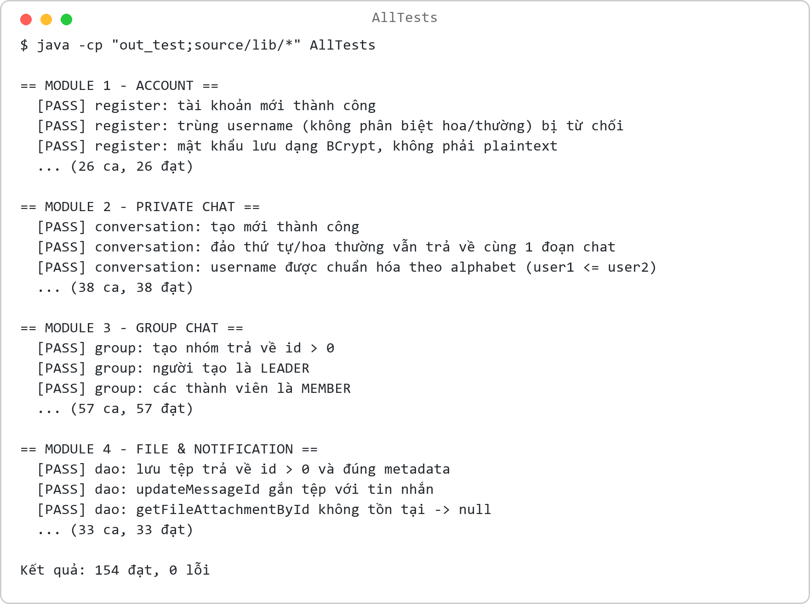
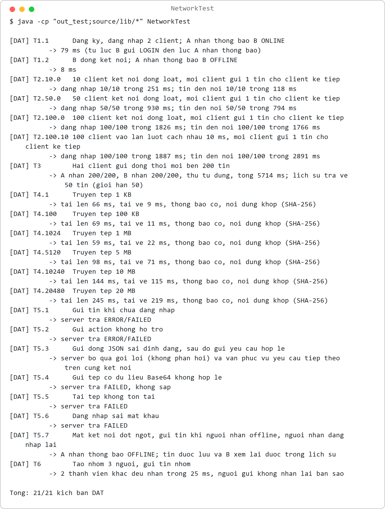
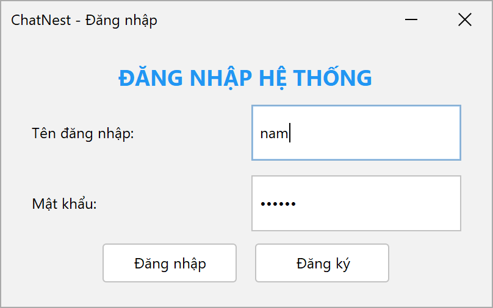
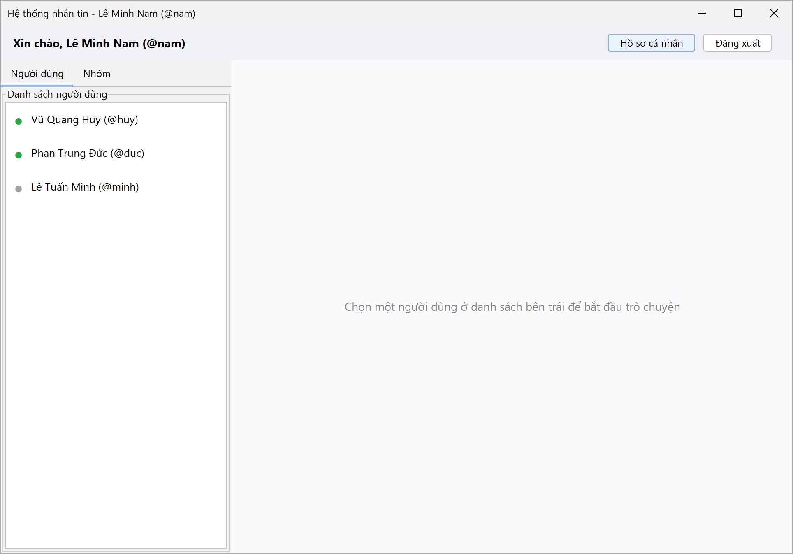
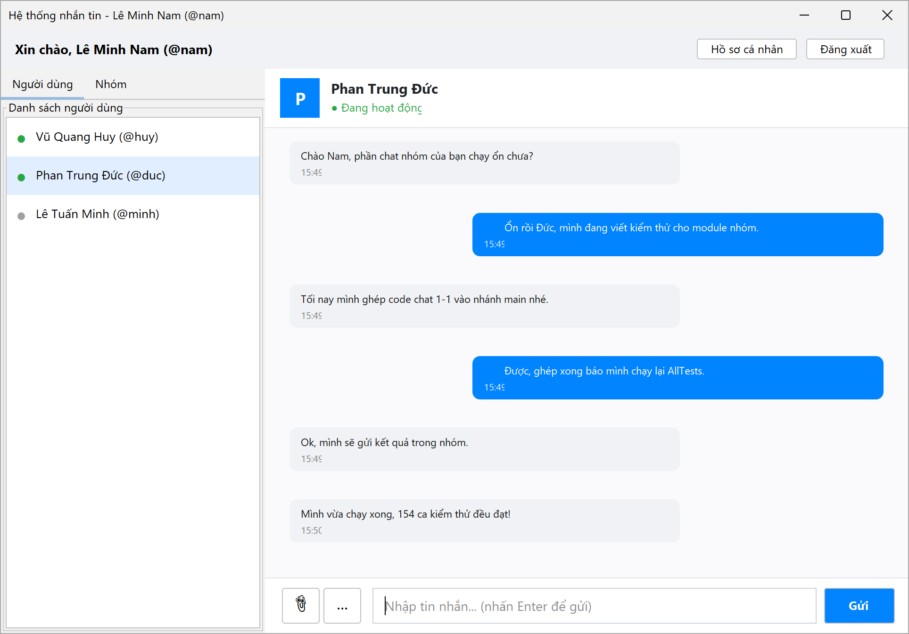
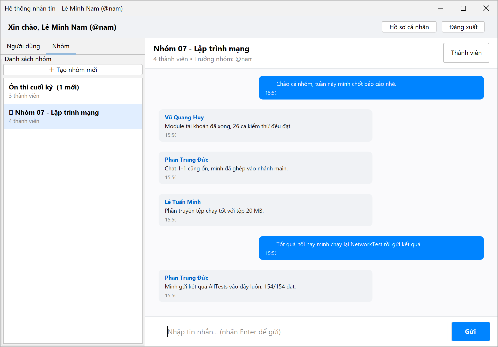
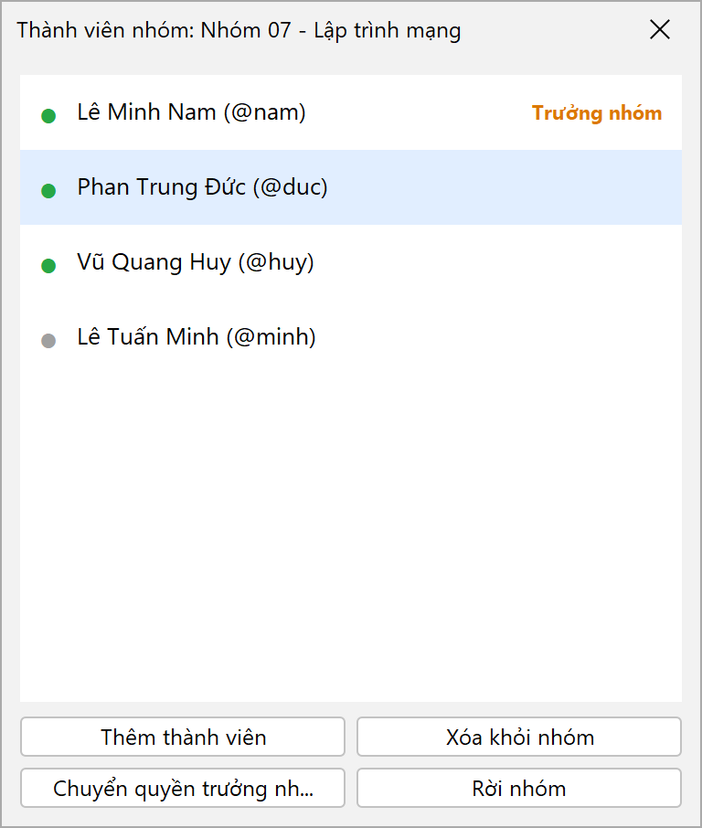
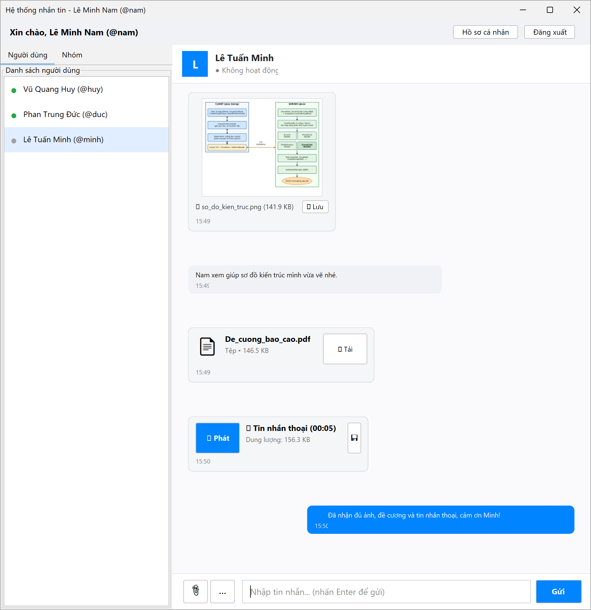
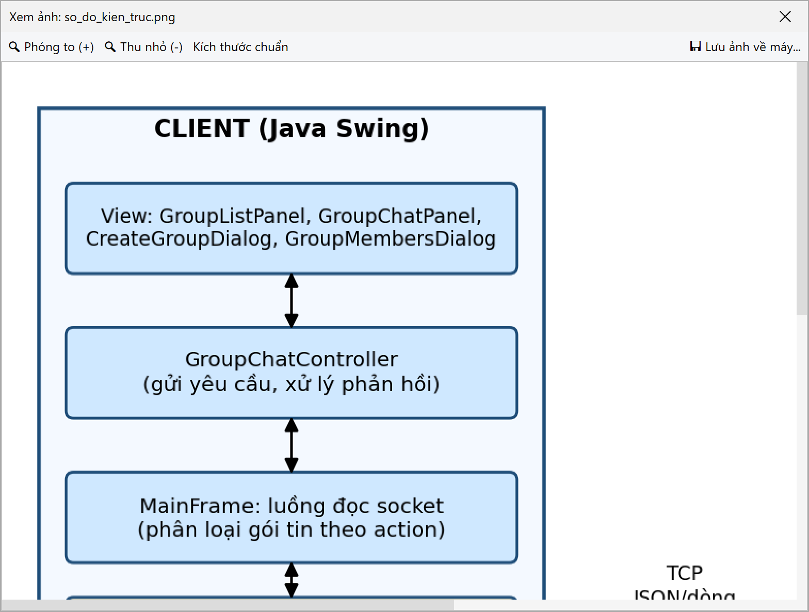
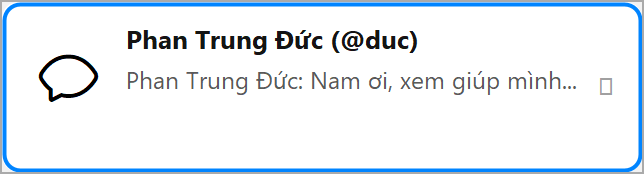

# BÀI TẬP LỚN: LẬP TRÌNH MẠNG  

## CHATNEST – HỆ THỐNG GIAO TIẾP VÀ TRAO ĐỔI DỮ LIỆU THỜI GIAN THỰC

---

## 🧑‍💻 THÔNG TIN NHÓM

| STT | Họ và Tên | MSSV | Email | Đóng góp |
|:---:|:---|:---:|:---|:---:|
| 1 | Phan Trung Đức | B23DCCN187 | Phanduc715@gmail.com | Module 2 (Private chat) |
| 2 | Vũ Quang Huy | B23DCCN412 | vuquanghuy18042005@gmail.com | Module 1 (account) + Thông báo|
| 3 | Lê Tuấn Minh | B23DCCN551 | tuanminh30042005@gmail.com | Module 4 (File) |
| 4 | Lê Minh Nam | B23DCCN579 | leminhnam325@gmail.com | Module 3 (Group Chat) |

**Tên nhóm:** Nhóm 07 – Lập trình mạng - INT1433-20261-09  
**Đề tài:** ChatNest – Hệ thống giao tiếp và trao đổi dữ liệu thời gian thực

---

## 🧠 MÔ TẢ HỆ THỐNG

**ChatNest** được xây dựng theo mô hình **Client - Server**, hỗ trợ người dùng giao tiếp, nhắn tin tức thời (chat 1-1 và chat nhóm), quản lý trạng thái trực tuyến và truyền tải file qua mạng.

Hệ thống bao gồm 4 module chức năng chính:
- **Module 1: Quản lý tài khoản & Trạng thái người dùng (`account`)**: Đăng ký, đăng nhập, đăng xuất, quản lý hồ sơ cá nhân, xem danh sách người dùng và theo dõi trạng thái online/offline, thông báo tin nhắn theo thời gian thực.
- **Module 2: Trò chuyện riêng tư (`private-chat`)**: Gửi và nhận tin nhắn riêng (1-1) trong thời gian thực, quản lý danh sách hội thoại, xem lịch sử tin nhắn và trạng thái đã đọc.
- **Module 3: Trò chuyện nhóm (`group-chat`)**: Tạo nhóm trò chuyện (tối thiểu 3 người), thêm/xóa thành viên, phân quyền trưởng nhóm, trưởng nhóm xóa (giải tán) nhóm, nhắn tin nhóm trong thời gian thực (văn bản, ảnh, video, tài liệu, ghi âm) và lưu trữ lịch sử tin nhắn nhóm.
- **Module 4: Truyền tải file & Thông báo (`file-notification`)**:
  - Hỗ trợ **Hình ảnh (`IMAGE`)**: Xem trước thumbnail ngay trên bong bóng chat, phóng to/thu nhỏ (Zoom Viewer), lưu ảnh về máy.
  - Hỗ trợ **Đoạn ghi âm (`AUDIO / VOICE NOTE`)**: Thu âm trực tiếp bằng microphone qua Java Sound API, phát lại âm thanh trực tiếp trong ứng dụng.
  - Hỗ trợ **Video (`VIDEO`)**: Xem video tự động bằng trình phát mặc định của hệ điều hành.
  - Hỗ trợ **Tệp tin tài liệu (`FILE`)**: Tải về các định dạng file đính kèm.
  - Gửi được trong **cả chat 1-1 và chat nhóm**. Tệp trong nhóm chỉ thành viên nhóm mới tải được, và bị xóa cùng nhóm.
  - **Hệ thống thông báo thời gian thực (`Notification Toast + Chime Sound`)**: Hiển thị popup góc màn hình kèm tiếng chuông du dương khi có tin/file mới, click để chuyển ngay tới đoạn chat.

**Cấu trúc logic tổng quát:**
```
Client (Swing UI) <---> Server Socket (TCP/IP) <---> SQLite Database (messaging_app.db)
```

---

## ⚙️ CÔNG NGHỆ SỬ DỤNG

| Thành phần | Công nghệ | Ghi chú |
|:---|:---|:---|
| **Ngôn ngữ** | Java (JDK 17+) | Lập trình mạng hướng đối tượng |
| **Giao thức mạng** | TCP Socket (`ServerSocket`, `Socket`) | Phân luồng đa kết nối qua `ExecutorService` |
| **Định dạng dữ liệu** | JSON (Google Gson 2.10.1) | Giao tiếp dòng lệnh (Line-delimited JSON) |
| **Giao diện Client** | Java Swing + FlatLaf 3.4 | Giao diện phẳng hiện đại, trực quan |
| **Cơ sở dữ liệu** | SQLite 3.50 + JDBC | Lưu trữ tài khoản, hội thoại, tin nhắn, tệp tin |
| **Bảo mật** | jBCrypt 0.4 | Băm mật khẩu người dùng |
| **Âm thanh** | Java Sound API (`javax.sound.sampled`) | Thu âm WAV Mono 16kHz & tổng hợp âm báo sóng sin |

---

## 🚀 HƯỚNG DẪN CHẠY DỰ ÁN

### 1. Clone repository
```bash
git clone https://github.com/leeminhnam/realtime-messaging-system.git
cd realtime-messaging-system
```

### 2. Khởi động Server
Tại thư mục gốc dự án:
```bash
java -cp "out/production/realtime-messaging-system;source/lib/*" ServerMain
```

### 3. Khởi động Client (mở nhiều terminal để chạy nhiều Client cùng lúc)
```bash
java -cp "out/production/realtime-messaging-system;source/lib/*" ClientMain
```

### 4. Kiểm thử nhanh
Bộ test (`source/test/`) bao phủ **cả 4 module** với tổng cộng **175 ca kiểm thử**, không cần thư viện test ngoài. Test dùng CSDL SQLite và thư mục upload tạm (thông qua `-Dchatnest.db.dir`, tự xóa khi kết thúc) nên **không ảnh hưởng** tới `messaging_app.db` thật. Handler được test trực tiếp bằng gói JSON, không cần mở socket hay giao diện.

```bash
# Biên dịch và chạy toàn bộ test của 4 module (tại thư mục gốc dự án, dùng Git Bash)
javac -encoding UTF-8 -cp "source/lib/*" -d out_test $(find source/server source/client source/test -name '*.java') && java -Dfile.encoding=UTF-8 -cp "out_test;source/lib/*" AllTests
```
> Trên Linux/macOS đổi `;` trong classpath thành `:`.

Chạy riêng từng module (sau khi đã biên dịch như trên, chỉ cần chạy lệnh `java`):
```bash
# Module 1 - Account (26 ca)
java -Dfile.encoding=UTF-8 -cp "out_test;source/lib/*" account.AccountModuleTest

# Module 2 - Private chat (38 ca)
java -Dfile.encoding=UTF-8 -cp "out_test;source/lib/*" private_chat.PrivateChatModuleTest

# Module 3 - Group chat (66 ca)
java -Dfile.encoding=UTF-8 -cp "out_test;source/lib/*" group_chat.GroupChatModuleTest

# Module 4 - File & Notification (45 ca)
java -Dfile.encoding=UTF-8 -cp "out_test;source/lib/*" file_notification.FileNotificationModuleTest
```

Kiểm thử mạng (khởi động Server thật và nhiều Client socket: kết nối đồng thời, trao đổi hai chiều, truyền tệp 1 KB đến 20 MB, lỗi và gián đoạn). Cần tắt Server đang chạy vì dùng cổng 8888, thời gian chạy khoảng 1 đến 2 phút:
```bash
java -Dfile.encoding=UTF-8 -cp "out_test;source/lib/*" NetworkTest
```

Kết quả mong đợi khi chạy `AllTests`: `Kết quả: 175 đạt, 0 lỗi` (thoát với mã 1 nếu có ca lỗi). Mỗi ca in `[PASS]` hoặc `[FAIL]` kèm mô tả. Phạm vi kiểm thử:

| Module | File test | Nội dung kiểm tra |
|--------|-----------|-------------------|
| 1 - Account | `account/AccountModuleTest` | `UserDAO`: đăng ký, chặn trùng username (không phân biệt hoa/thường), mật khẩu băm BCrypt, đăng nhập đúng/sai/không tồn tại, ONLINE/OFFLINE, cập nhật hồ sơ. `AccountHandler`: `REGISTER`, `LOGIN`, `UPDATE_PROFILE`, `GET_USER_LIST`, JSON sai định dạng. Cấu trúc gói broadcast `USER_STATUS_CHANGE` |
| 2 - Private chat | `private_chat/PrivateChatModuleTest` | `ConversationDAO`: một cặp user chỉ có một đoạn chat dù đảo thứ tự/hoa thường, chặn tự chat. `MessageDAO`: lưu, giới hạn và thứ tự lịch sử, đếm/đánh dấu đã đọc. `PrivateChatHandler`: kiểm tra đầu vào, chuyển tiếp realtime + thông báo cho người nhận online, cắt nội dung thông báo dài, lưu tin cho người nhận offline, lịch sử tự đánh dấu đã đọc |
| 3 - Group chat | `group_chat/GroupChatModuleTest` | `GroupDAO`: tạo nhóm, vai trò LEADER/MEMBER, thêm/xóa thành viên, chuyển quyền, xóa nhóm. `GroupMessageDAO`: lưu và lịch sử. `GroupChatHandler`: tạo nhóm (lọc trùng/user lạ, tối thiểu 3 người), phân quyền trưởng nhóm khi thêm/xóa/chuyển quyền, quy tắc rời nhóm, chỉ trưởng nhóm được xóa nhóm (gói `GROUP_DELETED` tới thành viên), gửi tin chuyển tiếp cho thành viên online (trừ người gửi), chặn người ngoài nhóm, gói `GROUP_UPDATED` |
| 4 - File & thông báo | `file_notification/FileNotificationModuleTest` | `FileAttachmentDAO`: lưu và truy vấn metadata. `FileNotificationHandler`: kiểm tra đầu vào (kể cả Base64 sai), lưu tệp ra đĩa với tên đã làm sạch, tin nhắn media JSON, thông báo `RECEIVE_NOTIFICATION` theo từng loại IMAGE/VIDEO/AUDIO/FILE, tải file khứ hồi khớp bản gốc, tệp mất trên đĩa. Gửi tệp/ghi âm vào nhóm (`SEND_GROUP_FILE`): chặn người ngoài nhóm, chuyển `RECEIVE_GROUP_MESSAGE` cho thành viên online, chỉ thành viên được tải, xóa nhóm thì xóa cả tệp |

> Phạm vi hiện tại là tầng server (DAO + handler). Chưa có test giao diện Swing và test tích hợp qua socket thật (xem mục Hướng phát triển).

---

## 🔗 GIAO TIẾP (GIAO THỨC SỬ DỤNG)

Client và Server giao tiếp qua **TCP Socket** (cổng mặc định `8888`, mã hóa UTF-8). Mỗi gói tin là **một đối tượng JSON trên một dòng** (kết thúc bằng `\n`) theo định dạng chung:

```json
// Request (Client -> Server)
{"action": "TÊN_ACTION", "data": { ... }}

// Response (Server -> Client)
{"action": "TÊN_ACTION_RESPONSE", "status": "SUCCESS | FAILED", "message": "...", "data": { ... }}
```

Server phân luồng gói tin theo `action` tới handler của từng module. Action không hỗ trợ nhận lại `{"action":"ERROR","status":"FAILED"}`.

| Module | Action (Request) | Dữ liệu `data` gửi lên | Phản hồi / Output |
|--------|------------------|------------------------|-------------------|
| 1 - Account | `REGISTER` | `username`, `password`, `fullName` | `REGISTER_RESPONSE` |
| 1 - Account | `LOGIN` | `username`, `password` | `LOGIN_RESPONSE` (kèm `fullName`, `avatar`, `allUsers`) |
| 1 - Account | `UPDATE_PROFILE` | `fullName`, `avatar` (tùy chọn) | `UPDATE_PROFILE_RESPONSE` |
| 1 - Account | `GET_USER_LIST` | — | `GET_USER_LIST_RESPONSE` (`users`) |
| 2 - Private chat | `SEND_PRIVATE_MESSAGE` | người nhận, nội dung | `SEND_PRIVATE_MESSAGE_RESPONSE` + đẩy tin tới người nhận |
| 2 - Private chat | `GET_CHAT_HISTORY` | đối tác hội thoại | `GET_CHAT_HISTORY_RESPONSE` |
| 2 - Private chat | `MARK_MESSAGES_READ` | đối tác hội thoại | Cập nhật trạng thái đã đọc |
| 3 - Group chat | `CREATE_GROUP`, `GET_MY_GROUPS`, `GET_GROUP_MEMBERS` | thông tin nhóm | Phản hồi dạng `<ACTION>_RESPONSE` |
| 3 - Group chat | `ADD_GROUP_MEMBER`, `REMOVE_GROUP_MEMBER`, `TRANSFER_LEADER`, `LEAVE_GROUP`, `DELETE_GROUP` | nhóm, thành viên | Phản hồi dạng `<ACTION>_RESPONSE` |
| 3 - Group chat | `SEND_GROUP_MESSAGE`, `GET_GROUP_HISTORY` | nhóm, nội dung | Phản hồi + đẩy tin tới các thành viên online |
| 4 - File | `SEND_FILE` | người nhận, tên/loại/kích thước file, nội dung Base64 | `SEND_FILE_RESPONSE` |
| 4 - File | `SEND_GROUP_FILE` | `groupId`, tên/loại/kích thước file, thời lượng ghi âm, nội dung Base64 | `SEND_GROUP_FILE_RESPONSE` + đẩy `RECEIVE_GROUP_MESSAGE` tới các thành viên online |
| 4 - File | `DOWNLOAD_FILE` | định danh file | `DOWNLOAD_FILE_RESPONSE` |

**Gói tin Server chủ động đẩy xuống Client (không cần request):**

| Action | Khi nào gửi | Nội dung `data` |
|--------|-------------|-----------------|
| `USER_STATUS_CHANGE` | Có người đăng nhập / đăng xuất / mất kết nối (broadcast tới mọi client online, trừ chính người đó) | `username`, `status` (`ONLINE`/`OFFLINE`), `fullName`, `avatar` (khi ONLINE) |
| `RECEIVE_NOTIFICATION` | Có tin nhắn hoặc file mới gửi tới người dùng | `sender`, `senderFullName`, `type`/`fileType`, `message` |
| `GROUP_DELETED` | Trưởng nhóm xóa nhóm (gửi tới mọi thành viên online của nhóm đó) | `groupId`, `groupName`, `deletedBy` |

Ví dụ luồng đăng nhập:
```json
→ {"action":"LOGIN","data":{"username":"alice","password":"pw123"}}
← {"action":"LOGIN_RESPONSE","status":"SUCCESS","message":"Đăng nhập thành công!","data":{"username":"alice","fullName":"Alice","avatar":"","status":"ONLINE","allUsers":[...]}}
← (tới client khác) {"action":"USER_STATUS_CHANGE","data":{"username":"alice","status":"ONLINE","fullName":"Alice","avatar":""}}
```

---

## 📊 KẾT QUẢ THỰC NGHIỆM

Thực nghiệm chạy trên một máy Windows 11 (Intel Core i5-11400H, 16 GB RAM, OpenJDK 22). Server và các Client kết nối qua `localhost:8888`. Toàn bộ ảnh nằm trong thư mục [`statics/results`](./statics/results).

### 1. Kiểm thử chức năng (`AllTests`)

Kết quả: **175/175 ca đạt**, chia theo bốn module: Account 26, Private chat 38, Group chat 66, File & Notification 45. Ảnh dưới đây giữ nguyên các dòng log thật; mỗi module chỉ hiện 3 ca đầu.



### 2. Kiểm thử hoạt động mạng (`NetworkTest`)

Chương trình khởi động Server thật và mở các Client bằng socket thật. Kết quả: **21/21 kịch bản đạt**.

| Kịch bản | Kết quả đo |
|:---|:---|
| Thông báo trạng thái ONLINE / OFFLINE | 79 ms / 8 ms |
| 10 / 50 / 100 Client kết nối đồng loạt, mỗi Client gửi 1 tin | Đăng nhập và nhận tin đủ 10/10, 50/50, 100/100 (tin đến đủ trong 118 / 794 / 1766 ms) |
| Hai Client gửi đồng thời mỗi bên 200 tin | Nhận đủ 200/200 mỗi bên, đúng thứ tự |
| Truyền tệp 1 KB đến 20 MB | Nội dung khớp SHA-256; tệp 20 MB tải lên 245 ms, tải về 219 ms |
| Dữ liệu sai, action lạ, JSON hỏng, mất kết nối đột ngột | Server trả lỗi hoặc bỏ qua gói hỏng, không bị dừng; tin gửi khi người nhận offline vẫn được lưu |
| Tin nhắn nhóm 3 người | 2 thành viên còn lại nhận được trong 25 ms |



> Số đo thời gian chỉ mang tính tham khảo: Server và Client chạy trên cùng một máy nên không có độ trễ mạng thực, và mỗi lần chạy cho kết quả hơi khác nhau.

### 3. Giao diện chương trình

| Đăng nhập | Cửa sổ chính, trạng thái online/offline |
|:---:|:---:|
|  |  |
| **Nhắn tin 1-1 thời gian thực** | **Nhắn tin nhóm, đánh dấu tin chưa xem** |
|  |  |
| **Quản lý thành viên nhóm** | **Gửi ảnh, tài liệu, tin nhắn thoại** |
|  |  |
| **Xem ảnh (phóng to, thu nhỏ, lưu)** | **Thông báo nổi khi có tin mới** |
|  |  |

---

## 🧩 CẤU TRÚC MÃ NGUỒN

```
realtime-messaging-system/
├── README.md
├── INSTRUCTION.md
├── MODULE4_DOCUMENTATION.md          # Tài liệu chi tiết kỹ thuật Module 4
├── statics/
│   ├── diagram.png
│   └── dataset_sample.csv
└── source/
    ├── lib/                          # Các thư viện jar phụ thuộc
    │   ├── flatlaf-3.4.jar
    │   ├── gson-2.10.1.jar
    │   ├── jbcrypt-0.4.jar
    │   └── sqlite-jdbc-3.50.3.0.jar
    ├── client/
    │   ├── ClientMain.java
    │   ├── MainFrame.java
    │   ├── account/                  # Đăng ký, đăng nhập, danh bạ
    │   ├── private_chat/             # Khung chat 1-1, bong bóng chat
    │   ├── group_chat/               # Module 3: Khung chat nhóm, thành viên, tạo nhóm
    │   └── file_notification/        # Module 4: Audio, Video, Image, Toast
    ├── test/
    │   ├── AllTests.java             # Chạy toàn bộ test của 4 module
    │   ├── testutil/TestSupport.java # Tiện ích test: CSDL tạm, ghi nhận kết quả, bắt gói JSON
    │   ├── account/                  # Test Module 1
    │   ├── private_chat/             # Test Module 2
    │   ├── group_chat/               # Test Module 3
    │   └── file_notification/        # Test Module 4
    └── server/
        ├── ServerMain.java
        ├── database/DatabaseManager.java
        ├── account/                  # Xử lý tài khoản
        ├── private_chat/             # Xử lý nhắn tin 1-1
        ├── group_chat/               # Module 3: Xử lý chat nhóm
        └── file_notification/        # Module 4: Xử lý tệp & thông báo
```
## 🧩 HƯỚNG PHÁT TRIỂN THÊM

**Bảo mật & xác thực**
- Mã hóa đường truyền bằng TLS/SSL (`SSLServerSocket`) thay cho TCP thuần
- Cấp token phiên (JWT) thay vì tin vào username của kết nối; giới hạn số lần đăng nhập sai
- Chức năng quên/đổi mật khẩu, xác thực email, đăng nhập một tài khoản trên nhiều thiết bị
- Phân quyền chi tiết hơn (quản trị viên, báo cáo người dùng vi phạm)

**Kết bạn & quan hệ người dùng**
- Tìm kiếm tài khoản theo tên, gửi/chấp nhận/từ chối/hủy lời mời kết bạn, quản lý danh sách bạn bè
- Chặn và bỏ chặn người dùng: người bị chặn không thể nhắn tin hay thêm mình vào nhóm
- Bổ sung các action mới như `FRIEND_REQUEST`, `FRIEND_ACCEPT`, `FRIEND_REJECT`, `UNFRIEND`, `BLOCK_USER`, `GET_FRIEND_LIST` và bảng `friendships` trong CSDL
- Server đẩy thông báo realtime khi có lời mời kết bạn; chỉ cho phép chat 1-1 giữa bạn bè (hoặc tách riêng hộp "tin nhắn chờ" cho người lạ)
- Chỉ broadcast `USER_STATUS_CHANGE` tới bạn bè thay vì mọi client online, giảm lưu lượng mạng
- Gợi ý kết bạn dựa trên nhóm chung

**Tính năng nhắn tin & nhóm**
- Thu hồi/chỉnh sửa tin nhắn, trả lời (reply) và thả cảm xúc (reaction)
- Hiển thị "đang nhập..." (typing indicator) và thời điểm hoạt động gần nhất
- Tìm kiếm tin nhắn, ghim tin nhắn, lưu trữ hội thoại
- Thêm vai trò phó nhóm, mời vào nhóm bằng liên kết, đổi tên và ảnh đại diện nhóm
- Gọi thoại/video (WebRTC hoặc UDP streaming)
- Thông báo ngoài ứng dụng (system tray), bật/tắt hoặc tùy chỉnh âm thanh thông báo

**Hiệu năng & kiến trúc**
- Truyền file lớn theo từng khối (chunk) thay cho Base64 một gói; hỗ trợ tiếp tục tải khi đứt kết nối
- Dùng Connection Pool (HikariCP) và NIO/Netty thay cho mô hình một luồng mỗi client
- Phân trang lịch sử tin nhắn, cơ chế heartbeat phát hiện client mất kết nối
- Chuyển CSDL từ SQLite sang PostgreSQL/MySQL khi tăng số lượng người dùng

**Chất lượng & triển khai**
- Bổ sung test tích hợp qua socket thật và test giao diện Swing; chuyển bộ test hiện tại sang JUnit + Maven/Gradle, tích hợp CI (GitHub Actions)
- Cải thiện giao diện người dùng (giao diện tối, đa ngôn ngữ, responsive)
- Đóng gói ứng dụng bằng Docker (server) và `jpackage` (client)
- Triển khai server trên cloud

---

## 📝 GHI CHÚ

- Repo tuân thủ đúng cấu trúc đã hướng dẫn trong `INSTRUCTION.md`.
- Đảm bảo test kỹ trước khi submit.

---

## 📚 TÀI LIỆU THAM KHẢO

> (Nếu có) Liệt kê các tài liệu, API docs, hoặc nguồn tham khảo đã sử dụng.

- **API docs:** [Postman Collection](https://www.postman.com/duc-s-team/workspace/my-workspace/collection/47918178-ac1b74a9-c408-4de4-907a-fd5cb8e45299?action=share&source=copy-link&creator=47918178)